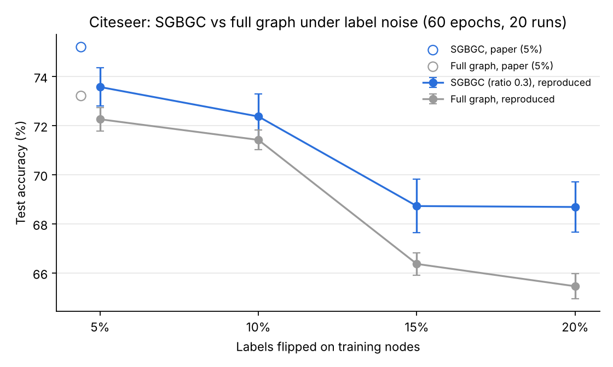

# Stage 1 - Reproducing SGBGC

Independent reproduction of **SGBGC** from *Graph Coarsening via Supervised Granular-Ball for Scalable Graph Neural Network Training* (Xia et al., AAAI-25), using the authors' released code ([mxjun17/GBNC](https://github.com/mxjun17/GBNC)) on **Cora, Citeseer and Co-CS**.

**Verdict:** the paper's main results reproduce, but only with the code's default of **60 training epochs**, not the 200 stated in the paper.

| Claim | Verdict | Evidence |
|---|---|---|
| Table 1: accuracy at fixed ratios | ✅ Reproduced | All 9 settings within 0.4 points (60 epochs) |
| Headline Co-CS result at 20× compression | ✅ Reproduced | 91.10% vs 91.21% |
| Table 2: adaptive ratio and accuracy | ✅ Reproduced | Ratios 0.455 / 0.486 / 0.408 vs 0.45 / 0.49 / 0.41; accuracy within 0.2 points |
| Accuracy close to the full graph | ✅ Reproduced | 0.3–1.1 points below a full-graph GCN |
| Fig. 4: robustness to label noise | ⚠️ Trend reproduced | Beats the noisy full graph at all 4 rates; absolute values ~1–1.6 points lower |
| Fig. 3: coarsening time | ⚠️ Partly | Co-CS 19.9 s vs 20.18 s; baseline speed-ups not checked |
| Comparisons with baselines | ❌ Not checked | No baseline code released |

## Results

All numbers are test accuracy (%), mean ± std over 20 seeded runs, regenerated from [`results/results.jsonl`](results/results.jsonl) by [`scripts/make_report.py`](scripts/make_report.py). Full tables: [`results/tables.md`](results/tables.md).

### Table 1 — accuracy at fixed coarsening ratios

| Dataset | Ratio | Paper | Reproduced, 60 epochs | Diff | Reproduced, 200 epochs | Diff |
|---|---|---|---|---|---|---|
| Cora | 0.5 | 87.85 ± 0.64 | 87.95 ± 0.93 | +0.10 | 84.83 ± 1.00 | -3.02 |
| Cora | 0.3 | 86.29 ± 0.79 | 86.12 ± 0.91 | -0.17 | 84.85 ± 1.36 | -1.44 |
| Cora | 0.1 | 82.99 ± 1.00 | 82.59 ± 1.23 | -0.40 | 83.94 ± 1.14 | +0.95 |
| Citeseer | 0.5 | 75.25 ± 1.02 | 75.21 ± 0.73 | -0.04 | 74.73 ± 1.10 | -0.52 |
| Citeseer | 0.3 | 75.73 ± 0.88 | 75.69 ± 1.35 | -0.04 | 75.11 ± 1.14 | -0.62 |
| Citeseer | 0.1 | 73.69 ± 0.93 | 73.60 ± 1.08 | -0.09 | 72.67 ± 0.83 | -1.02 |
| Co-CS | 0.3 | 93.09 ± 0.13 | 93.09 ± 0.13 | +0.00 | 93.22 ± 0.14 | +0.13 |
| Co-CS | 0.1 | 92.22 ± 0.22 | 92.16 ± 0.14 | -0.06 | 92.11 ± 0.27 | -0.11 |
| Co-CS | 0.05 | 91.21 ± 0.30 | 91.10 ± 0.54 | -0.11 | 91.57 ± 0.28 | +0.36 |

**Key finding:** the paper states 200 epochs, but its Table 1 numbers match the code default of 60 epochs almost exactly (Co-CS at 0.3: identical). At 200 epochs, Cora at ratio 0.5 drops by 3 points.

### Table 2 — adaptive ratio and full-graph GCN (60 epochs)

| Dataset | Ratio, paper | Ratio, reproduced | SGBGC, paper | SGBGC, reproduced | FULL, paper | FULL, reproduced |
|---|---|---|---|---|---|---|
| Cora | 0.45 | 0.455 (1,231 balls) | 87.57 | 87.42 ± 0.86 | 88.38 | 88.48 ± 0.23 |
| Citeseer | 0.49 | 0.486 (1,617 balls) | 75.38 | 75.34 ± 0.65 | 76.48 | 76.07 ± 0.44 |
| Co-CS | 0.41 | 0.408 (7,488 balls) | 93.28 | 93.38 ± 0.14 | 93.78 | 93.69 ± 0.17 |

### Label noise (Fig. 4)



SGBGC stays above the full graph trained on the same noisy labels at every noise rate (gap 0.95–3.23 points at 60 epochs). This reproduces the *effect*; it does not show *why* (correction of noisy labels vs dilution through majority voting in mixed balls).

### Fig. 3 — coarsening time

| Dataset | Ratio | Paper | Reproduced |
|---|---|---|---|
| Cora | 0.3 | 4.92 s | 1.1 s |
| Citeseer | 0.3 | 3.47 s | 0.7 s |
| Co-CS | 0.05 | 20.18 s | 19.9 s |

## Deviations from the original setup

Changes needed to run the paper's experiments with the released code:

- **Epochs:** run at both 60 (code default) and 200 (paper).
- **Adaptive mode:** not exposed in the code. Reconstructed by removing the ball budget and disabling `split_ball_further`, so splitting stops once every ball is pure. The resulting ratios match the paper's.
- **Noise rate:** hard-coded at 10% in the code. The same flipping rule is parameterised here to 5–20%, with a single fixed draw (seed 0) applied to training labels only.
- **Seeds:** run *i* uses seed *i*; the original code is unseeded.
- **Left as in the original:** the GCN ignores the `--dropout` argument and uses PyTorch's default of 0.5.

## Context for interpreting the results

- **Labels used during coarsening:** training **and validation** labels (60% + 20% of nodes) shape the partition. Test labels are hidden (set to −1), so there is no test-label leakage, but the setting is label-rich.
- **Dropped nodes:** nodes in regions with no known labels are dropped from the coarse graph (41 of 2,708 on Cora at ratio 0.3). Evaluation still covers every test node, because prediction runs on the full graph.
- **Purity at fixed ratios:** purity reaches 1 only when the ball budget allows it. At low ratios some balls stay mixed (60 of 270 on Cora at ratio 0.1).
- **What ± measures:** coarsening is deterministic, so ± reflects only the train/val split and weight initialisation.

## Not reproduced

Baseline methods (no code released), speed-ups over baselines (Fig. 3), memory usage (Fig. 5), the initial-centre sweep (Fig. 6), and the Pubmed and Co-Physics datasets.

## How to reproduce

```bash
git clone https://github.com/Shambhavi-DSAI2006/semi-supervised-graph-coarsening.git
cd semi-supervised-graph-coarsening/reproduction
pip install -r requirements.txt
bash scripts/setup.sh                      # fetches the authors' code (commit a60c882) and Co-CS data

# One configuration (about 1 minute on CPU):
python repro.py table1 cora 0.5 0.3 0.1 --epochs 60

# Everything (about 3 hours on a 2-core CPU, mostly Co-CS):
bash scripts/run_all.sh
python scripts/make_report.py              # rebuilds results/tables.md and the figure
```

Expected output for the single configuration: `86.12 ± 0.91` at ratio 0.3 (seeded, deterministic on CPU).

## Repository layout

```
repro.py                 all experiments: table1 | adaptive | full | noise
scripts/setup.sh         clone the authors' code at a pinned commit; fetch datasets
scripts/run_all.sh       run every configuration reported here
scripts/make_report.py   build tables and figure from raw results
results/results.jsonl    raw results: one line per configuration, all 20 per-run accuracies
results/tables.md        generated comparison tables
figures/                 generated figures
```

## Environment

CPU only (2 cores), Python with the versions in [`requirements.txt`](requirements.txt). The paper used a Xeon W-2245 with an RTX 3090.

## Citation

This repository reproduces:

```bibtex
@inproceedings{xia2025sgbgc,
  title     = {Graph Coarsening via Supervised Granular-Ball for Scalable Graph Neural Network Training},
  author    = {Xia, Shuyin and Ma, Xinjun and Liu, Zhiyuan and Liu, Cheng and Zhao, Sen and Wang, Guoyin},
  booktitle = {Proceedings of the AAAI Conference on Artificial Intelligence},
  volume    = {39},
  year      = {2025}
}
```

The original code belongs to its authors and is not redistributed here. The scripts in this repository are MIT-licensed.
