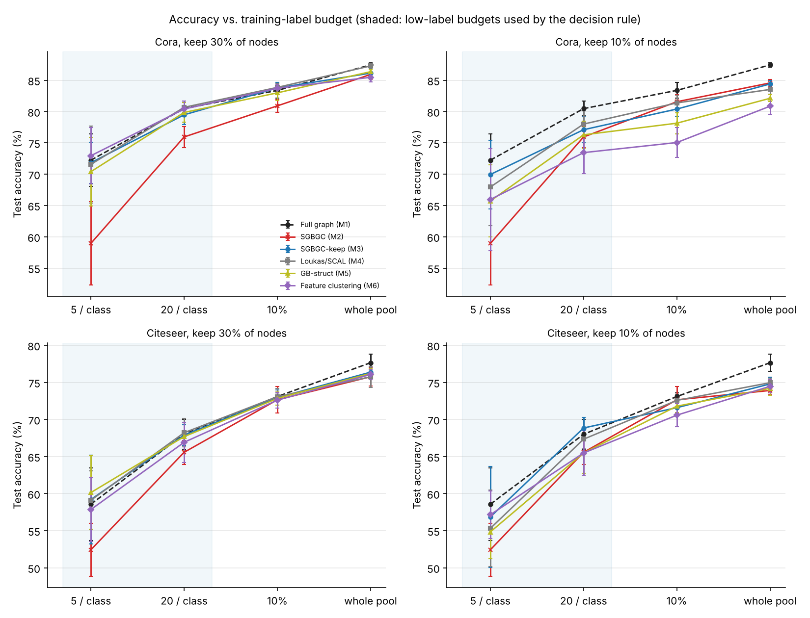

# Stage 2 - Does label-aware coarsening still help when labels are scarce?

**Result: PIVOT** under the pre-registered decision rule. Keeping unlabelled nodes fixes most of SGBGC's collapse at low label rates, but the fixed method is no better than label-free coarsening (Loukas/SCAL) followed by the same semi-supervised training.

- Protocol, written before any result: [PROTOCOL.md](PROTOCOL.md) (with Amendment 1, made before any test result)
- Research log, including exploratory observations and candidate pivots: [LOG.md](LOG.md)
- Full tables: [results/summary.md](results/summary.md)

## Decision

| Dataset | Best label-free method | H1 gap: SGBGC-keep − SGBGC | H2 gap: SGBGC-keep − best label-free |
|---|---|---|---|
| Cora | Loukas/SCAL (M4) (74.5) | +7.15 (95% CI ±1.52) | +0.04 (95% CI ±1.25) |
| Citeseer | Loukas/SCAL (M4) (62.5) | +4.20 (95% CI ±2.59) | +0.71 (95% CI ±1.79) |

- Decision: **PIVOT** — SGBGC-keep is ≤ 1 point better than the best label-free method on both datasets.
- H1 (discarding unlabelled nodes is the main cause): **supported**.

Gaps are means over the low-label budgets (5 and 20 per class) and both ratios. CIs are over seeds, from paired per-seed differences (reported, not part of the rule).

## Accuracy vs. label budget



## What this means

- **SGBGC's collapse is a design flaw, not a law of nature.** Discarding unlabelled nodes costs 4-7 points at 5-20 labels per class; keeping them recovers it (H1 supported).
- **On these graphs, labels do not make coarsening better** once nothing is discarded (H2 refuted): Loukas/SCAL coarsening matches SGBGC-keep within 1 point.
- **At 30% of nodes, coarsened training already matches the full graph** at low label rates, so there is little for labels to recover. A gap to the full graph appears at 10%, clearly on Cora (about 3 points) and less clearly on Citeseer.

These conclusions are limited to two small, homophilous citation graphs, one GCN configuration and 10 seeds. See LOG.md for candidate next directions.

## Reproduce

```bash
cd stage2
pip install -r ../reproduction/requirements.txt -r requirements.txt
python prepare.py                       # fetches SGBGC and the Loukas library
python run.py                           # 880 runs; ~2.5 h on 2 CPU cores
python analyze.py                       # tables, decision rule, figure
```

`python run.py --smoke` runs a development check (seed 99) that never computes test accuracy.
