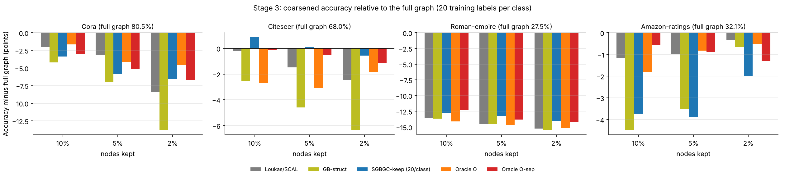

# Stage 3 - Is there headroom for labels in coarsening?

**Result: "target found", but in one cell only (Cora at 2% of nodes), and the evidence is weak.** In the other 11 settings, coarsening with many labels (oracle) was not more than 1.4 points better than the best label-free coarsening. The two heterophilous graphs could not answer the question: with 20 labels per class the GCN barely learns on them (floor effect).

- Protocol, written before any result: [PROTOCOL.md](PROTOCOL.md) (Amendment 1 before test results; Amendment 2, a bug fix, after - decision unchanged)
- Research log, including my assessment and next steps: [LOG.md](LOG.md)
- Full tables: [results/summary.md](results/summary.md)

## Headroom per cell

| Dataset | Keep | Best label-free | Best oracle | H = oracle − label-free | G = oracle − SGBGC-keep | Target cell? |
|---|---|---|---|---|---|---|
| Cora | 10% | Loukas/SCAL (78.5) | Oracle O (78.8) | +0.37 ± 1.60 | +1.73 ± 1.98 | no |
| Cora | 5% | Loukas/SCAL (77.4) | Oracle O (76.4) | -1.01 ± 1.70 | +1.74 ± 3.11 | no |
| Cora | 2% | Loukas/SCAL (72.0) | Oracle O (75.9) | +3.86 ± 2.14 | +2.01 ± 3.51 | **yes** |
| Citeseer | 10% | Loukas/SCAL (67.8) | Oracle O-sep (67.8) | +0.07 ± 1.16 | -1.00 ± 0.73 | no |
| Citeseer | 5% | Loukas/SCAL (66.5) | Oracle O-sep (67.5) | +0.94 ± 1.41 | -0.62 ± 0.62 | no |
| Citeseer | 2% | Loukas/SCAL (65.5) | Oracle O-sep (66.9) | +1.34 ± 1.25 | -0.58 ± 0.64 | no |
| Roman-empire | 10% | Loukas/SCAL (13.9) | Oracle O-sep (15.2) | +1.26 ± 1.17 | +0.46 ± 0.73 | no |
| Roman-empire | 5% | GB-struct (13.0) | Oracle O-sep (13.6) | +0.67 ± 0.64 | -0.63 ± 1.06 | no |
| Roman-empire | 2% | Loukas/SCAL (12.2) | Oracle O-sep (13.3) | +1.13 ± 1.41 | -0.15 ± 0.43 | no |
| Amazon-ratings | 10% | Loukas/SCAL (30.9) | Oracle O-sep (31.5) | +0.60 ± 2.97 | +3.16 ± 2.42 | no |
| Amazon-ratings | 5% | Loukas/SCAL (31.1) | Oracle O (31.3) | +0.18 ± 4.04 | +3.05 ± 2.63 | no |
| Amazon-ratings | 2% | Loukas/SCAL (31.8) | Oracle O (31.6) | -0.18 ± 4.14 | +1.49 ± 3.17 | no |

- Decision: **TARGET FOUND** in: Cora at 2%

H = how much labels could add (best oracle minus best label-free coarsening). G = how much 20 labels per class fall short of the oracle. ± = 95% CI from paired per-seed differences. A target cell needs H >= 3 (CI above 0) and G >= 2.



## What this means

- **Little headroom on these graphs.** Even many labels rarely make granular-ball coarsening better than label-free coarsening.
- **The one target cell is fragile:** Cora at 2% has H = +3.9 (CI +1.7 to +6.0), but G's CI includes zero, so 20 labels may already capture it.
- **Heterophilous graphs need a better base setup.** Full-graph GCN: Roman-empire 27.5% (majority class 14.0%), Amazon-ratings 32.1% (majority class 36.8%). Coarsened models on Roman-empire are at the majority-class level for every method.
- **Exploratory hint:** at strong compression, SGBGC-keep with only 20 labels per class beats label-free coarsening on Citeseer (+1.9 ± 1.3 at 2%) and even beats the oracles there. Keeping the few labelled nodes apart may matter more than having many labels - a hypothesis for the next protocol.

## Reproduce

```bash
cd stage3
pip install -r ../reproduction/requirements.txt -r ../stage2/requirements.txt
python prepare.py              # SGBGC code, Loukas library, heterophilous datasets
python run.py                  # 640 runs; ~2 h on 2 CPU cores
python analyze.py              # tables, decision rule, figure
```
