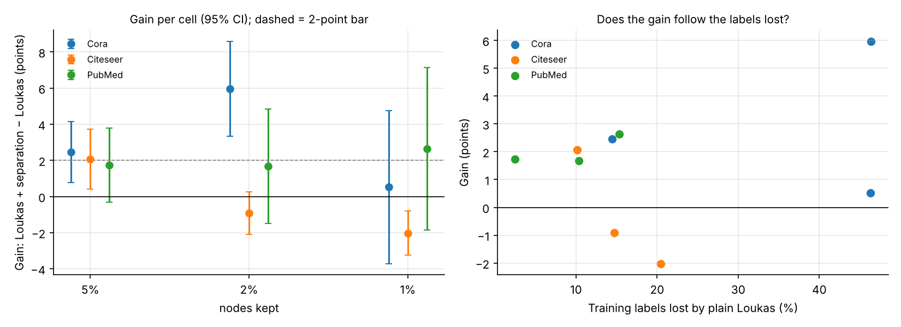

# Stage 4 - Does keeping labelled nodes apart improve coarsening?

**Result: GO under the pre-registered rule, but the evidence is modest.** One new rule added to label-free coarsening (Loukas/SCAL) - never let a super-node contain training nodes of more than one class - improved accuracy on Cora and PubMed, not on Citeseer. The effect is large and robust in one setting (Cora at 2% of nodes: +6 points), passes narrowly elsewhere, and can hurt when the rule takes too much budget from the rest of the graph.

- Protocol, written before any result: [PROTOCOL.md](PROTOCOL.md)
- Research log, including sensitivity checks and my assessment: [LOG.md](LOG.md)
- Full tables: [results/summary.md](results/summary.md)

## Decision

| Dataset | Gain: M7 − M4 (mean of 3 ratios) | Passes (≥ 2, CI > 0)? |
|---|---|---|
| Cora | +2.98 ± 1.44 | **yes** |
| Citeseer | -0.29 ± 0.78 | no |
| PubMed | +2.02 ± 2.01 | **yes** |

- Decision: **GO** — label separation gains ≥ 2 points on at least 2 of 3 datasets.

Gain = accuracy of Loukas + label separation (M7) minus plain Loukas (M4), same number of super-nodes, averaged over keeping 5%, 2% and 1% of nodes; ± = 95% CI over 10 new seeds with new random splits.

## Per cell

| Dataset | Keep | Full graph | M4 Loukas | M7 Loukas + sep | M3 SGBGC-keep | M7 − M4 | M3 − M4 | Labels lost by M4 |
|---|---|---|---|---|---|---|---|---|
| Cora | 5% | 81.0 | 76.7 ± 2.3 | 79.2 ± 1.6 | 75.5 ± 1.9 | +2.46 ± 1.69 | -1.23 ± 1.62 | 20 / 140 (14%) |
| Cora | 2% | 81.0 | 68.6 ± 3.2 | 74.6 ± 2.7 | 74.4 ± 2.7 | +5.97 ± 2.62 | +5.82 ± 2.83 | 65 / 140 (46%) |
| Cora | 1% | 81.0 | 65.4 ± 3.4 | 65.9 ± 6.3 | 55.4 ± 8.7 | +0.52 ± 4.23 | -10.06 ± 5.78 | 65 / 140 (46%) |
| Citeseer | 5% | 66.8 | 64.2 ± 3.0 | 66.3 ± 1.1 | 67.2 ± 2.1 | +2.07 ± 1.66 | +2.93 ± 2.23 | 12 / 120 (10%) |
| Citeseer | 2% | 66.8 | 64.9 ± 2.0 | 64.0 ± 2.5 | 65.6 ± 2.2 | -0.91 ± 1.17 | +0.69 ± 1.21 | 18 / 120 (15%) |
| Citeseer | 1% | 66.8 | 65.3 ± 2.7 | 63.3 ± 3.0 | 65.5 ± 2.3 | -2.02 ± 1.22 | +0.18 ± 1.40 | 24 / 120 (20%) |
| PubMed | 5% | 76.8 | 73.1 ± 2.9 | 74.9 ± 1.7 | 73.1 ± 3.0 | +1.73 ± 2.04 | -0.07 ± 1.93 | 2 / 60 (2%) |
| PubMed | 2% | 76.8 | 71.7 ± 2.5 | 73.3 ± 3.8 | 73.2 ± 2.1 | +1.68 ± 3.16 | +1.56 ± 2.18 | 6 / 60 (10%) |
| PubMed | 1% | 76.8 | 68.9 ± 5.7 | 71.5 ± 2.9 | 73.9 ± 2.1 | +2.64 ± 4.50 | +4.96 ± 3.22 | 9 / 60 (15%) |



## Caveats

- **PubMed passes by a hair** (CI lower bound +0.01).
- **Size matching:** 6 of 90 Cora runs ended outside the ±2% size match, 4 of them with more super-nodes for M7. Without those runs Cora's average gain is +1.9 ± 2.8 (would not pass); the Cora 2% effect stays at +6.0 ± 3.1.
- **The pre-stated prediction was partly wrong:** gains did not follow the share of labels lost (Citeseer lost more labels than PubMed but gained nothing).

## What this suggests

Separation has a cost: splitting clashing super-nodes forces the rest of the graph to be merged harder. Gains fit "labels saved minus budget spent": the rule helps when it is cheap (PubMed) or saves many labels (Cora 2%), and hurts when it is expensive (Citeseer at 1-2%). The next method component should **protect training labels without taking budget from the rest of the graph**. See LOG.md.

## Reproduce

```bash
cd stage4
pip install -r ../reproduction/requirements.txt -r ../stage2/requirements.txt
python ../stage2/prepare.py      # SGBGC code and the Loukas library
python run.py                    # 300 runs; ~45 min on 2 CPU cores
python analyze.py                # tables, decision rule, figure
```
