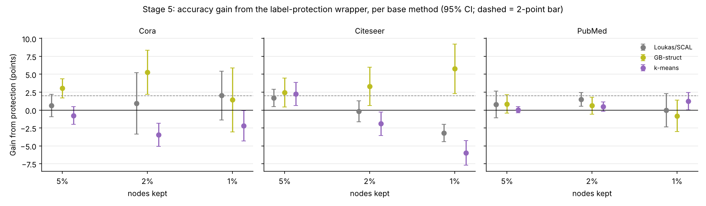

# Stage 5 - Does a general label-protection wrapper improve any coarsening method?

**Result: INCONCLUSIVE under the pre-registered rule - the wrapper is not a general improvement.** It helps a weak structural coarsener (GB-struct: +3.3 on Cora, +3.8 on Citeseer), barely changes Loukas, and hurts a strong feature-based one (k-means: -2.1 on Cora).

- Protocol, written before any result: [PROTOCOL.md](PROTOCOL.md)
- The wrapper: [protect.py](protect.py) (separate clashing super-nodes, then rebalance to the same size)
- Research log, with my reading and options: [LOG.md](LOG.md)
- Full tables: [results/summary.md](results/summary.md)

## Decision

Gain = (base + protection) − base, averaged over keeping 5%, 2% and 1% of nodes.

| Base method | Cora | Citeseer | PubMed | Datasets passing |
|---|---|---|---|---|
| Loukas/SCAL | +1.20 ± 1.96 | -0.57 ± 1.02 | +0.75 ± 1.17 | 0 / 3 |
| GB-struct | +3.25 ± 1.34 ✓ | +3.84 ± 1.86 ✓ | +0.21 ± 1.11 | 2 / 3 |
| k-means | -2.13 ± 0.92 | -1.88 ± 1.16 | +0.58 ± 0.45 | 0 / 3 |

- Decision: **INCONCLUSIVE** — 1 of 3 base methods pass on ≥ 2 datasets; clearly harmed: k-means on Cora.



## What this means

- **Protecting labels helps when the base partition is poor and hurts when it is good.** The wrapper repairs groups using graph connections; for k-means, which groups by features, that breaks groups that already match the classes.
- **A general fixed repair is weaker than recomputing.** For Loukas, the rebalanced version was below Stage 4's split-and-re-run version in every cell.
- **Exploratory:** plain k-means on smoothed features was the most accurate of the three base methods in all 9 cells, close to the full graph even at 1-2% of nodes.

## References

| Dataset | Keep | Full graph | Loukas | Loukas + protection | Loukas + Stage 4 separation | protection − Stage 4 |
|---|---|---|---|---|---|---|
| Cora | 5% | 80.4 | 76.1 | 76.8 | 79.2 | -2.40 ± 1.37 |
| Cora | 2% | 80.4 | 73.4 | 74.3 | 74.8 | -0.44 ± 2.82 |
| Cora | 1% | 80.4 | 66.5 | 68.6 | 72.4 | -3.81 ± 3.71 |
| Citeseer | 5% | 66.5 | 64.5 | 66.2 | 66.6 | -0.35 ± 0.94 |
| Citeseer | 2% | 66.5 | 64.0 | 63.8 | 64.3 | -0.54 ± 1.35 |
| Citeseer | 1% | 66.5 | 64.8 | 61.6 | 61.7 | -0.10 ± 1.63 |
| PubMed | 5% | 78.2 | 73.2 | 74.0 | 74.5 | -0.56 ± 1.70 |
| PubMed | 2% | 78.2 | 70.9 | 72.4 | 72.8 | -0.35 ± 2.53 |
| PubMed | 1% | 78.2 | 69.5 | 69.5 | 71.6 | -2.19 ± 4.44 |

## Reproduce

```bash
cd stage5
pip install -r ../reproduction/requirements.txt -r ../stage2/requirements.txt
python ../stage2/prepare.py      # SGBGC code and the Loukas library
python run.py                    # 660 runs; ~90 min on 2 CPU cores
python analyze.py                # tables, decision rule, figure
```
