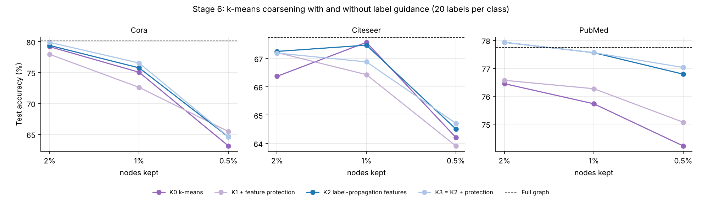

# Stage 6 - Can a few labels improve feature k-means coarsening?

**Result: INCONCLUSIVE.** Label-propagation features (K2) improve k-means coarsening on PubMed (+2.0 points, reaching the full graph's accuracy at 1-2% of nodes) but add little on Cora (+0.8) and Citeseer (+0.4), where k-means alone is already close to the full graph.

- Protocol, written before any result: [PROTOCOL.md](PROTOCOL.md)
- Methods: [guided.py](guided.py)
- Research log, including the literature check that changes the project's positioning: [LOG.md](LOG.md)
- Full tables: [results/summary.md](results/summary.md)

## Decision

| Dataset | Gain K2 − K0 (mean of 3 ratios) | Passes (≥ 1.5, CI > 0)? |
|---|---|---|
| Cora | +0.79 ± 2.30 | no |
| Citeseer | +0.36 ± 1.04 | no |
| PubMed | +1.96 ± 1.78 | **yes** |

- Decision: **INCONCLUSIVE** — neither condition met.



## Per cell

| Dataset | Keep | Full graph | K0 | K1 | K2 | K3 | K2 − K0 | K1 − K0 | K3 − K0 | Labels lost by K0 |
|---|---|---|---|---|---|---|---|---|---|---|
| Cora | 2% | 80.1 | 79.2 | 78.0 | 79.4 | 79.9 | +0.20 ± 1.45 | -1.24 ± 1.42 | +0.70 ± 1.40 | 24/140 |
| Cora | 1% | 80.1 | 75.1 | 72.6 | 75.8 | 76.6 | +0.71 ± 3.63 | -2.45 ± 2.71 | +1.49 ± 3.47 | 28/140 |
| Cora | 0.5% | 80.1 | 63.1 | 65.5 | 64.6 | 64.6 | +1.46 ± 5.06 | +2.34 ± 3.54 | +1.50 ± 5.14 | 37/140 |
| Citeseer | 2% | 67.8 | 66.4 | 67.2 | 67.2 | 67.2 | +0.88 ± 1.36 | +0.84 ± 0.68 | +0.82 ± 1.42 | 17/120 |
| Citeseer | 1% | 67.8 | 67.6 | 66.4 | 67.5 | 66.9 | -0.10 ± 1.55 | -1.14 ± 0.95 | -0.69 ± 1.60 | 20/120 |
| Citeseer | 0.5% | 67.8 | 64.2 | 63.9 | 64.5 | 64.7 | +0.30 ± 1.92 | -0.30 ± 2.63 | +0.50 ± 2.05 | 24/120 |
| PubMed | 2% | 77.7 | 76.5 | 76.6 | 77.9 | 77.9 | +1.48 ± 1.54 | +0.12 ± 0.67 | +1.48 ± 1.54 | 1/60 |
| PubMed | 1% | 77.7 | 75.7 | 76.3 | 77.6 | 77.6 | +1.83 ± 2.29 | +0.54 ± 0.60 | +1.83 ± 2.29 | 3/60 |
| PubMed | 0.5% | 77.7 | 74.2 | 75.1 | 76.8 | 77.0 | +2.57 ± 2.50 | +0.85 ± 0.73 | +2.81 ± 2.37 | 5/60 |

## What this means

- k-means on smoothed features already captures most of what matters at 1-2% of nodes; the few labels add a little, mainly on PubMed.
- The approach is **not novel**: CGC (WWW 2025) condenses graphs by clustering propagated features within classes, and LAGC (UAI 2024) is a published semi-supervised coarsening method. Both are required baselines from now on.
- The open gap to test next: condensation methods summarise only the labelled nodes, while coarsening keeps all nodes, so coarsening may win when labels are very scarce. See LOG.md.

## Reproduce

```bash
cd stage6
pip install -r ../reproduction/requirements.txt -r ../stage2/requirements.txt
python run.py                    # 390 runs; ~70 min on 2 CPU cores
python analyze.py
```
